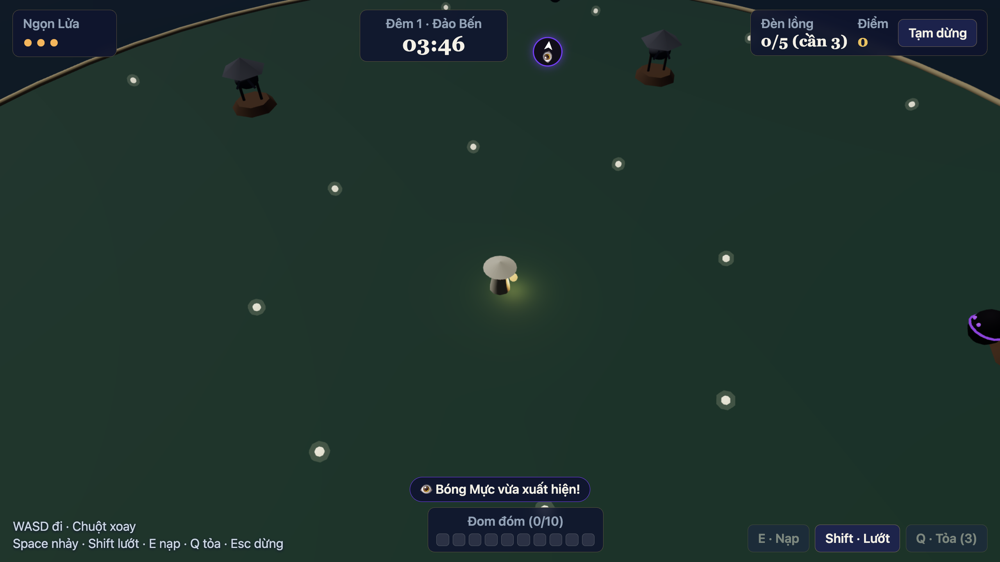
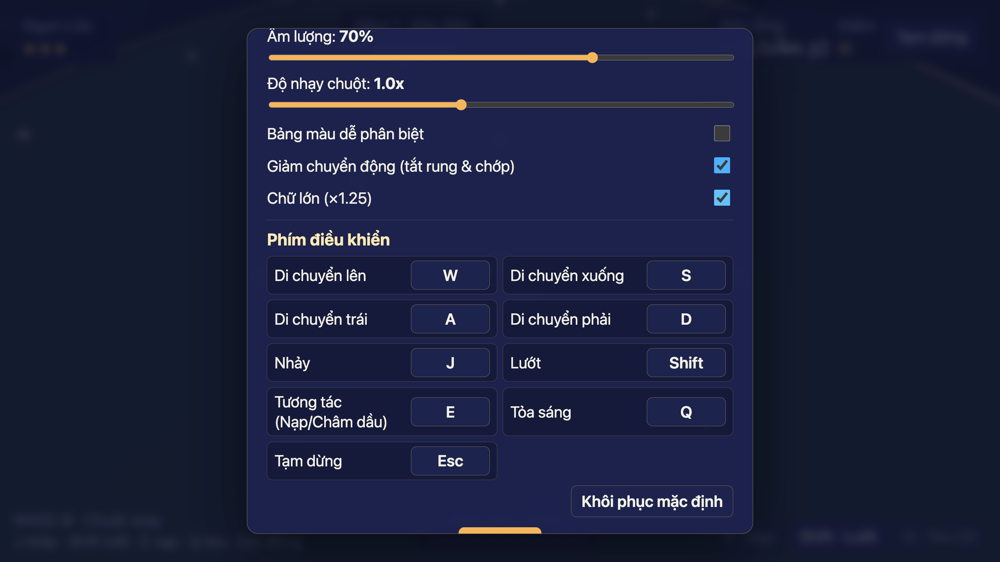
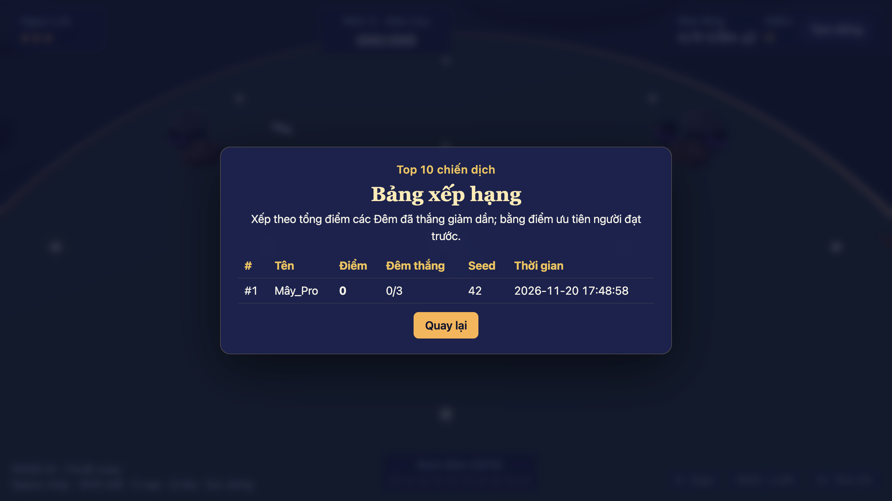
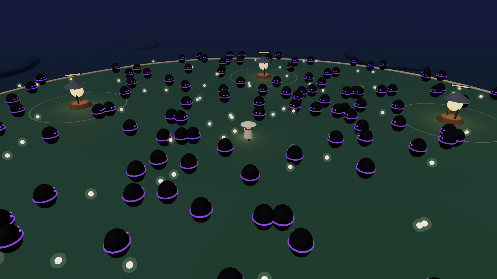

# Đảo Đèn Lồng — v1.0.0 (Day 12 · AI SDLC)

> **Video demo (< 5 phút):** [Tải / xem `demo.mp4` tại Release `v1.0.0`](https://github.com/chrislethedimsum/K5-L3A-DAY12-LeXuanPhuc-2A202603655-AI-SDLC-Dao-Den-Long/releases/download/v1.0.0/demo.mp4) *(sau khi tạo Release `v1.0.0` và đính kèm `demo.mp4`, liên kết mở trực tiếp khi chưa đăng nhập)*.

Game hành động sinh tồn 3D góc nhìn thứ ba viết bằng **TypeScript + Three.js + Node.js**, tách biệt hoàn toàn lõi mô phỏng tất định 60 Hz (`src/core/`) khỏi phần hiển thị 3D WebGL (`src/client/`). Đồng hành cùng Mây qua 3 Đêm (**Đảo Bến**, **Đảo Cau**, **Đảo Chuông**), thu gom đom đóm, thắp & châm dầu giữ Đèn Lồng Lớn sáng tới bình minh, né Bóng Mực và Gió Lạc, vượt chuẩn hiệu năng (`796.6 FPS`), soak test 10 Đêm (`0 crashes`), bảng xếp hạng cục bộ và đầy đủ 4 tính năng dễ tiếp cận.



## Yêu cầu hệ thống

- **Node.js 22+** (đã kiểm thử với Node `v26.13.1` trên macOS arm64; tương thích Linux/macOS)
- **Trình duyệt hỗ trợ WebGL2** (Chrome/Edge/Firefox/Safari) để chơi bản 3D
- **Google Chrome / Chromium** (tùy chọn, dùng cho lệnh đo hiệu năng `bench_cmd`) hoặc **Docker** (tùy chọn)

## Cài đặt và chạy game (tối đa 3 lệnh)

```sh
npm ci
npm run build
npm start
```

Mở `http://127.0.0.1:4173` bằng trình duyệt hỗ trợ WebGL2.

- **Chạy bằng bản phát hành đóng gói (Release `v1.0.0`):** giải nén `dao-den-long-v1.0.0-web.tar.gz`, vào thư mục và chạy `node run.mjs`.
- **Chạy bằng Docker:**

```sh
docker build -t dao-den-long .
docker run --rm -p 4173:4173 dao-den-long
```

## Điều khiển & Khả năng tiếp cận (Accessibility)

| Hành động | Phím mặc định | Ghi chú |
|---|---|---|
| Di chuyển (4 hướng) | `W` `A` `S` `D` / `↑ ← ↓ →` | Kéo giữ chuột xoay góc nhìn |
| Nhảy | `Space` | Lên dốc, cầu tre, nhảy né |
| Lướt (`Dash`) | `Shift` (`L`) | `14 m/s` trong `0.2 s`, hồi `1.5 s` |
| Nạp / Thắp lại / Châm dầu | `E` | `10` lần đầu, `5` thắp lại, châm dầu `+10/mote` |
| Tỏa sáng (`Pulse`) | `Q` | Tốn `3` đom đóm, đẩy `4 m`, choáng `2 s` (`+15` khi đang `drain`) |
| Tạm dừng | `Esc` (`P`) | Giữ nguyên đồng hồ, nhiên liệu và thực thể |

### 4 tính năng Tiếp cận (Cài đặt & Tiếp cận)
1. **Đổi phím toàn bộ 9 hành động:** Hỗ trợ đổi từng phím, kiểm tra xung đột phím ngay lập tức (không ghi đè trùng) và có nút **"Khôi phục mặc định"**, lưu tự động vào `localStorage`.
2. **Phụ đề hình ảnh & chỉ báo hướng:** Hiển thị đồng thời trong khay phụ đề (`role="status"`) khi **Bóng Mực xuất hiện** (kèm mũi tên hướng `👁➤` ở mép màn hình), **Gió mạnh sắp/đang thổi**, **10 s cuối trước bình minh**, và **đèn có `fuel < 30`**.
3. **Giảm chuyển động (`Giảm chuyển động`) + Chế độ mù màu (`Bảng màu dễ phân biệt`):** Tắt rung camera, chớp màn hình và hạt trang trí; đổi Bóng Mực sang `#00B3FF`, cảnh báo `#FFFFFF` + `⚠`, đèn tắt xẹp 20% kèm vết rách.
4. **Cỡ chữ UI `>= 18 px` ở `1280×720` & tùy chọn chữ lớn (`×1.25`):** Mọi nhãn, nút, phụ đề, bảng xếp hạng và form trong HUD đều đạt `>= 18 px` ở `1280×720` và phóng tỷ lệ `×1.25` sạch sẽ khi bật.



## Bảng xếp hạng cục bộ & Xuất JSON

- Sau khi thắng Đêm 3 (**Bình Minh**) hoặc thua ở bất kỳ Đêm nào (`1–3`), người chơi nhập tên (`3–12` ký tự `[A-Za-z0-9_]`, hỗ trợ tiếng Việt có dấu) để lưu tổng điểm các Đêm đã thắng.
- Giữ top 10 (sắp xếp `score` giảm dần, bằng điểm ưu tiên đạt trước), lưu bền vững xuống đĩa (`~/.dao-den-long/leaderboard.json`, có thể đổi thư mục qua biến môi trường `DAO_DEN_LONG_DATA_DIR`), xem trực tiếp từ Menu chính.
- Xuất ra tệp JSON chuẩn `{"entries": [...]}`:

```sh
node scripts/run.mjs --export-leaderboard out.json
```



## Test, Chế độ Headless, Benchmark & Soak Test (Contract v1.3)

Chạy toàn bộ kiểm chứng tự động (6 bộ test · 84 test cases + `tsc` + `vite build` + `build:headless` + `collect-proof`):

```sh
npm run verify
node scripts/collect-proof.mjs
```

Các lệnh chuẩn khai báo trong [game.contract.json](game.contract.json):

```sh
# 1. Headless CLI (--night 1 | 2 | 3)
node dist-headless/src/headless/cli.js --seed 42 --night 1 --ticks 1200 --out trace.jsonl

# 2. Benchmark 3D 1280x720 (tắt vsync, 200 Bóng Mực + 100 đom đóm + L1-L3, 3s warmup + 30s đo)
node scripts/bench.mjs --seed 42 --duration 30 --out bench.json

# 3. Soak test 10 Đêm liên tiếp cùng tiến trình
node --jitless --max-semi-space-size=1 --no-lazy --optimize-for-size --expose-gc dist-headless/src/headless/soak.js --seed 7 --nights 10 --out soak.json
```

> **Ghi chú về Vsync trong Benchmark:** [scripts/bench.mjs](scripts/bench.mjs) khởi chạy Chrome ở cửa sổ không toàn màn hình `1280×720` với cờ `--disable-frame-rate-limit` và `--disable-gpu-vsync` (tắt giới hạn đồng bộ khung hình), đo được `avg_fps: 796.6`, `p1_low_fps: 365.6`, `frame_ms_p95: 2.5 ms`, `load_ms: 1768 ms`, `peak_mem_mb: 805.8 MB` trên macOS 15.7.8 (Apple M4 Pro) — xem chi tiết tại [bench.json](bench.json) và [docs/proof/phase-4.md](docs/proof/phase-4.md).



## Sáng tạo của tôi

Theo Rubric mục F, các điểm sáng tạo bổ sung đều được giữ gọn **100% ở tầng hiển thị & trải nghiệm (`src/client/`)**, không làm thay đổi bất kỳ luật, số liệu, Test Contract v1.3, kết quả benchmark hay soak test nào:

1. **Bầu trời ửng hồng lúc cận bình minh & 40 hạt tàn lửa vàng quanh đèn sáng (`src/client/scene.ts`):** Trong 30 giây cuối đêm hoặc khi thắng, ánh trăng và nền trời chuyển ấm dần; các đèn sáng có `THREE.Points` tàn lửa bốc nhẹ (1 draw call). Tự động **tắt hoàn toàn** khi bật `?bench=1` hoặc chế độ `Giảm chuyển động`.
2. **Nhạc chuông ngũ cung Việt tổng hợp bằng Web Audio (`src/client/audio.ts`):** Hiệu ứng thắp đèn và qua Đêm phát quãng ngũ cung tổng hợp trực tiếp bằng `AudioContext`, không dùng tệp âm thanh ngoài.
3. **Thẻ tóm tắt chiến thuật cuối Đêm (`src/client/hud.ts`):** Hiển thị số đèn thắp mới, thắp lại, châm dầu, lần Tỏa Sáng phá Bóng Mực đang hút dầu và số đòn trúng phải (chỉ đọc đếm từ event trình duyệt).

**Bằng chứng không ảnh hưởng lõi & benchmark/soak:**
- Kiểm tra tự động trong [tests/unit/phase4.test.ts](tests/unit/phase4.test.ts) xác nhận mọi tệp trong `src/core/` không import `src/client/`, không truy cập `document`/`window`/`localStorage`/`AudioContext`.
- Đầu ra headless Đêm 1–3 chạy 2 lần khớp từng byte (`SHA-256` lưu ở [docs/proof/determinism-night1.log](docs/proof/determinism-night1.log), [determinism-night2.log](docs/proof/determinism-night2.log), [determinism-night3.log](docs/proof/determinism-night3.log)); `scene.setBenchMode(true)` tắt tàn lửa, ửng sáng và rung/chớp camera trước khi đo `bench.json`.

## Tài liệu, Bằng chứng & Harness AI

- **Hợp đồng kiểm thử v1.3:** [game.contract.json](game.contract.json)
- **Kiến trúc & thay đổi:** [docs/adr/001-lantern-fuel-and-dawn-survival.md](docs/adr/001-lantern-fuel-and-dawn-survival.md) · [CHANGELOG.md](CHANGELOG.md) · [CREDITS.md](CREDITS.md) · [LICENSE](LICENSE)
- **Bằng chứng từng phase:** [phase-1.md](docs/proof/phase-1.md) · [phase-2.md](docs/proof/phase-2.md) · [phase-3.md](docs/proof/phase-3.md) · [phase-4.md](docs/proof/phase-4.md)
- **Giả định, AI & Retro:** [notes/phase-1.md](docs/notes/phase-1.md) · [notes/phase-2.md](docs/notes/phase-2.md) · [notes/phase-3.md](docs/notes/phase-3.md) · [notes/phase-4.md](docs/notes/phase-4.md) · **[Retro tổng hợp 4 Phase](docs/notes/retro.md)**
- **Harness AI:** [AGENTS.md](AGENTS.md) · [.agents/skills/verify-phase/SKILL.md](.agents/skills/verify-phase/SKILL.md) · [.github/workflows/ci.yml](.github/workflows/ci.yml)
